<div class="mycontent pf-top">

A collection of things that I've built and shipped - packages, small web
apps, and the odd game. Most of them started as tools for my own use, and
all of them are open source.

## My packages

I've authored several R packages, which are all available on [GitHub](https://www.github.com/martinctc):

</div>

```{=html}
<div class="pf-rowblock">
<div class="row">
<a class="pf-card col-12 col-md-4" href="https://martinctc.github.io/surveytoolbox" target="_blank" rel="noopener">
<div class="pf-thumb"><span class="pf-badge">R</span>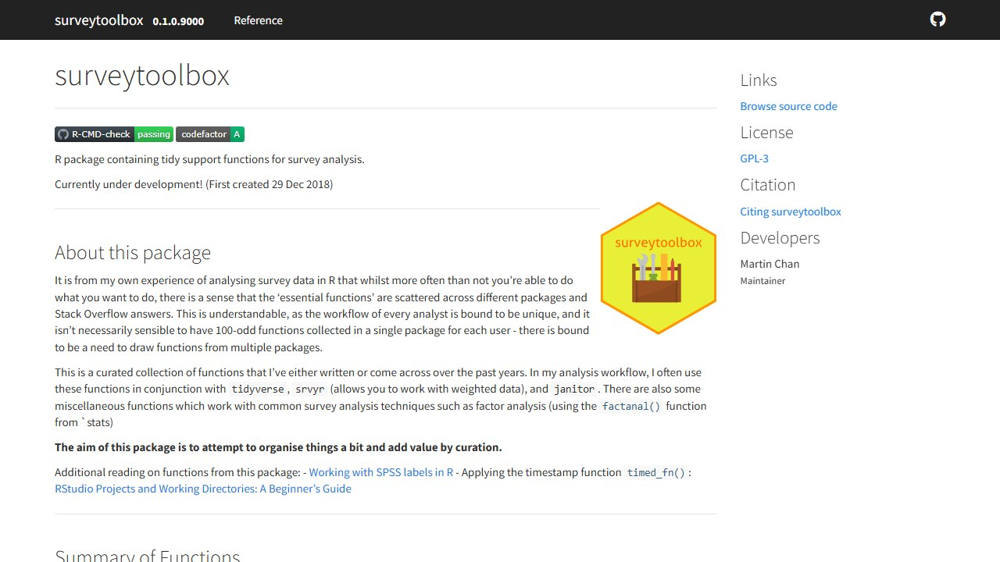<span class="pf-cardtitle">surveytoolbox</span></div>
<div class="pf-cap"><div class="pf-oneliner">Tidy support functions for survey analysis.</div></div>
</a>
<a class="pf-card col-12 col-md-4" href="https://github.com/martinctc/tstoolbox" target="_blank" rel="noopener">
<div class="pf-thumb pf-thumb--css pf-css-r"><span class="pf-badge">R</span><span class="pf-glyph">&#128200;</span><span class="pf-cardtitle">tstoolbox</span></div>
<div class="pf-cap"><div class="pf-oneliner">Useful tools for time series analysis in R.</div></div>
</a>
<a class="pf-card col-12 col-md-4" href="https://martinctc.github.io/rwa" target="_blank" rel="noopener">
<div class="pf-thumb"><span class="pf-badge">R</span>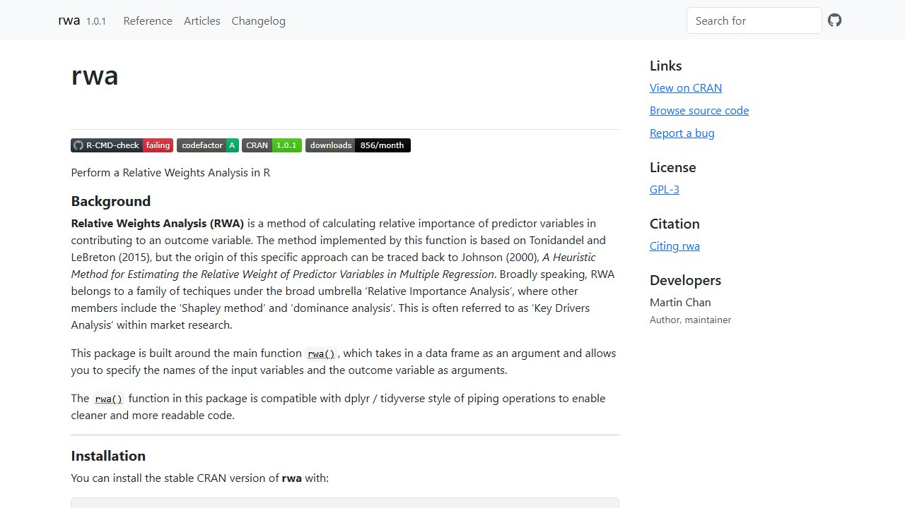<span class="pf-cardtitle">rwa</span></div>
<div class="pf-cap"><div class="pf-oneliner">Perform a Relative Weights Analysis in R.</div></div>
</a>
<a class="pf-card col-12 col-md-4" href="https://github.com/martinctc/textworks" target="_blank" rel="noopener">
<div class="pf-thumb pf-thumb--css pf-css-r"><span class="pf-badge">R</span><span class="pf-glyph">&#128221;</span><span class="pf-cardtitle">textworks</span></div>
<div class="pf-cap"><div class="pf-oneliner">Save time working with survey and text data!</div></div>
</a>
<a class="pf-card col-12 col-md-4" href="https://github.com/martinctc/zipcodes" target="_blank" rel="noopener">
<div class="pf-thumb pf-thumb--css pf-css-r"><span class="pf-badge">R</span><span class="pf-glyph">&#128506;</span><span class="pf-cardtitle">zipcodes</span></div>
<div class="pf-cap"><div class="pf-oneliner">US zip codes database for R.</div></div>
</a>
<a class="pf-card col-12 col-md-4" href="https://github.com/martinctc/modeltoolbox" target="_blank" rel="noopener">
<div class="pf-thumb pf-thumb--css pf-css-r"><span class="pf-badge">R</span><span class="pf-glyph">&#9881;</span><span class="pf-cardtitle">modeltoolbox</span></div>
<div class="pf-cap"><div class="pf-oneliner">Convenience functions for building models in R.</div></div>
</a>
<a class="pf-card col-12 col-md-4" href="https://martinctc.github.io/gpxtoolbox/" target="_blank" rel="noopener">
<div class="pf-thumb"><span class="pf-badge">R</span>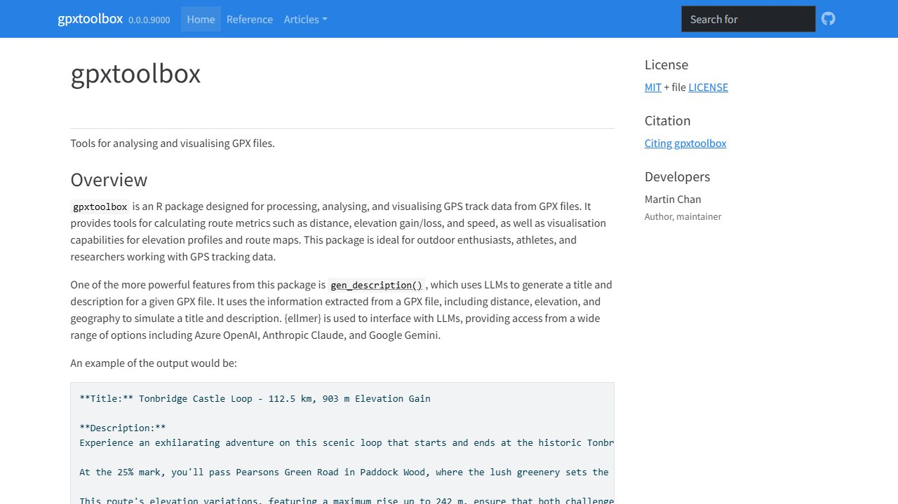<span class="pf-cardtitle">gpxtoolbox</span></div>
<div class="pf-cap"><div class="pf-oneliner">Tools for analysing and visualising GPX files.</div></div>
</a>
<a class="pf-card col-12 col-md-4" href="https://martinctc.github.io/parallaxr" target="_blank" rel="noopener">
<div class="pf-thumb"><span class="pf-badge">R</span>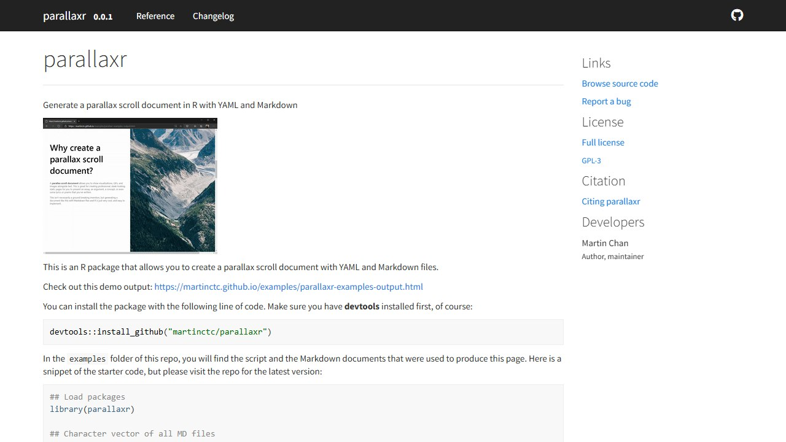<span class="pf-cardtitle">parallaxr</span></div>
<div class="pf-cap"><div class="pf-oneliner">Generate a parallax scroll document in R with YAML and Markdown.</div></div>
</a>
<a class="pf-card col-12 col-md-4" href="https://martinctc.github.io/devtoolbox" target="_blank" rel="noopener">
<div class="pf-thumb"><span class="pf-badge">R</span>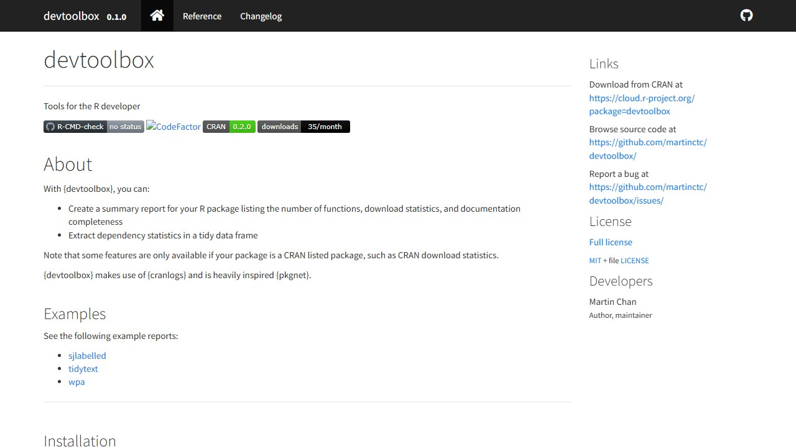<span class="pf-cardtitle">devtoolbox</span></div>
<div class="pf-cap"><div class="pf-oneliner">Tools for the R developer.</div></div>
</a>
<a class="pf-card col-12 col-md-4" href="https://martinctc.github.io/mschart2/" target="_blank" rel="noopener">
<div class="pf-thumb"><span class="pf-badge">R</span>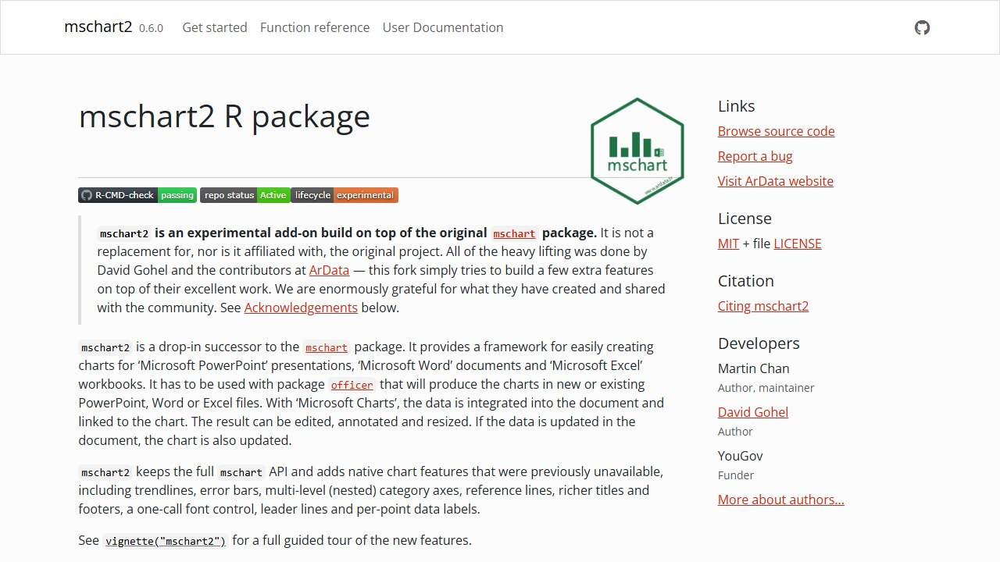<span class="pf-cardtitle">mschart2</span></div>
<div class="pf-cap"><div class="pf-oneliner">Experimental add-on to {mschart} with native Office chart features.</div></div>
</a>
<a class="pf-card col-12 col-md-4" href="https://hong-kong-districts-info.github.io/hkdatasets/" target="_blank" rel="noopener">
<div class="pf-thumb"><span class="pf-badge">R</span>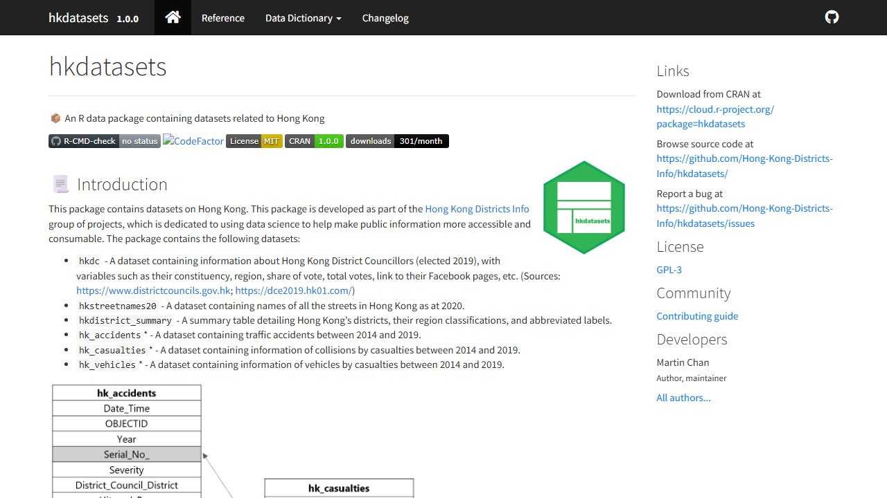<span class="pf-cardtitle">hkdatasets</span></div>
<div class="pf-cap"><div class="pf-oneliner">An R data package containing datasets related to Hong Kong.</div></div></a>
</div>
```
</div>

<div class="mycontent">

Most of these packages were to some extent "by-products" of the analysis that I've been doing for the last couple of years, which I decided would have greater value developed into packages. 

In addition, I maintain the following packages as part of my work with Microsoft Viva Insights: 

</div>

```{=html}
<div class="pf-rowblock">
<div class="row">
<a class="pf-card col-12 col-md-4" href="https://microsoft.github.io/vivainsights/" target="_blank" rel="noopener">
<div class="pf-thumb"><span class="pf-badge">R</span>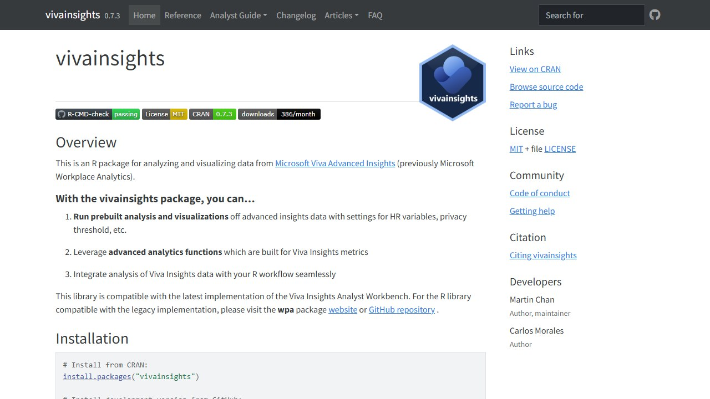<span class="pf-cardtitle">vivainsights</span></div>
<div class="pf-cap"><div class="pf-oneliner">Analyze and visualize Viva Insights data in R.</div></div>
</a>
<a class="pf-card col-12 col-md-4" href="https://microsoft.github.io/vivainsights-py/" target="_blank" rel="noopener">
<div class="pf-thumb"><span class="pf-badge">Python</span>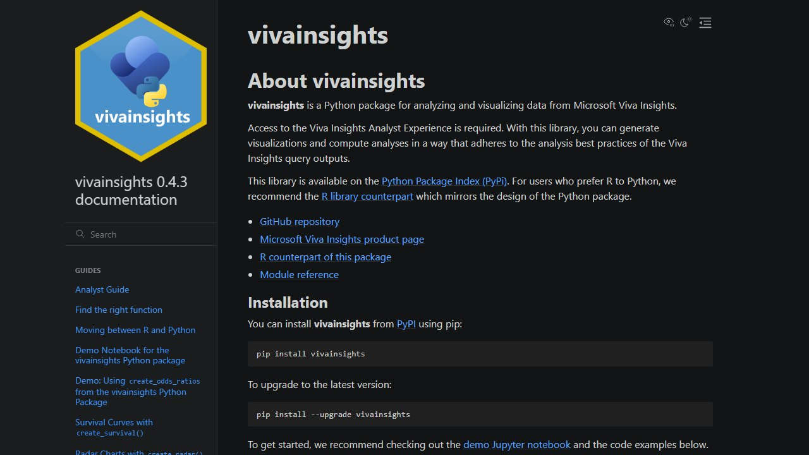<span class="pf-cardtitle">vivainsights-py</span></div>
<div class="pf-cap"><div class="pf-oneliner">Analyze and visualize Viva Insights data in Python.</div></div>
</a>
<a class="pf-card col-12 col-md-4" href="https://microsoft.github.io/wpa/" target="_blank" rel="noopener">
<div class="pf-thumb"><span class="pf-badge">R</span>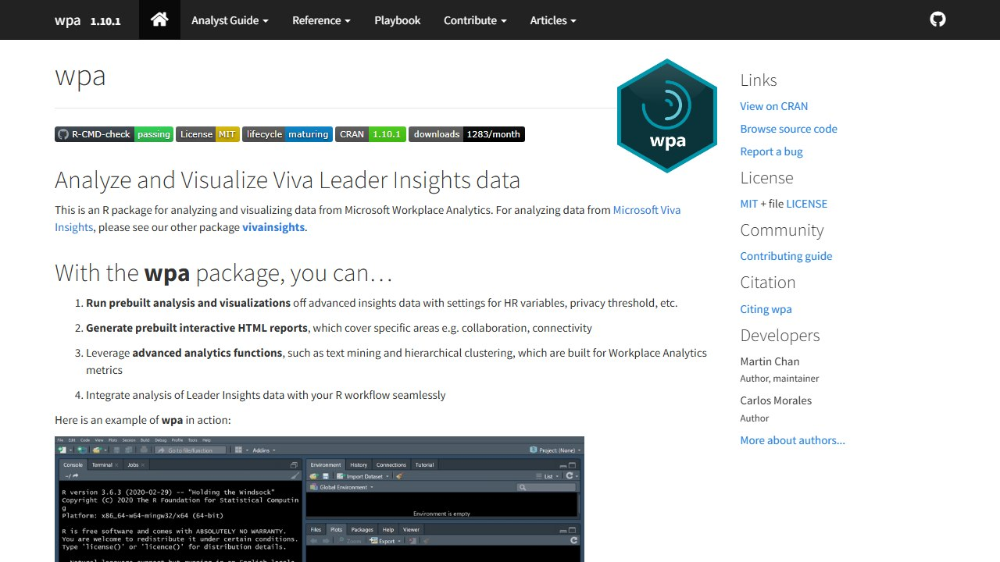<span class="pf-cardtitle">wpa</span></div>
<div class="pf-cap"><div class="pf-oneliner">Analyze and visualize Microsoft Workplace Analytics data in R.</div></div></a>
</div>
</div>

<div class="mycontent">

If you have any comments or questions about these packages, please get in touch - any feedback would be valuable!

```
---

## Vibe-coded projects

Alongside R packages, I've recently been building small web apps and tools
through "vibe coding" — quick, exploratory builds where I use AI-assisted
development to turn an idea into a working tool as directly as possible.
These are typically self-contained, browser-based, and built for a specific
real-world need of mine.

</div>

```{=html}
<div class="pf-rowblock">
<div class="row">
<a class="pf-card col-12 col-md-4" href="projects.html#track-tag-manager">
<div class="pf-thumb"><span class="pf-badge">Python</span>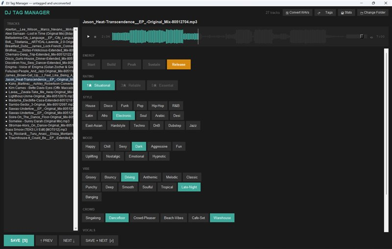<span class="pf-cardtitle">Track Tag Manager</span></div>
<div class="pf-cap"><div class="pf-oneliner">A local Python app for tagging and organising tracks, designed for DJ workflows.</div></div>
</a>
<a class="pf-card col-12 col-md-4" href="projects.html#tri-harder">
<div class="pf-thumb"><span class="pf-badge">TypeScript</span>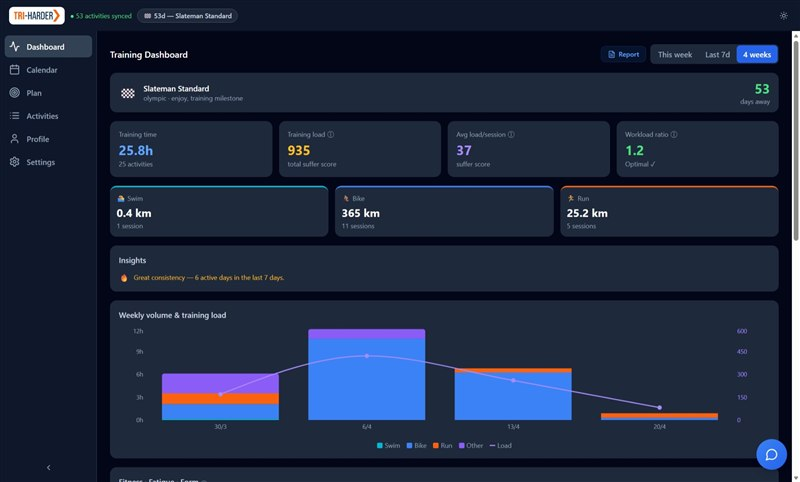<span class="pf-cardtitle">Tri Harder</span></div>
<div class="pf-cap"><div class="pf-oneliner">An AI-powered triathlon coaching app.</div></div>
</a>
<a class="pf-card col-12 col-md-4" href="projects.html#wrava">
<div class="pf-thumb"><span class="pf-badge">TypeScript</span>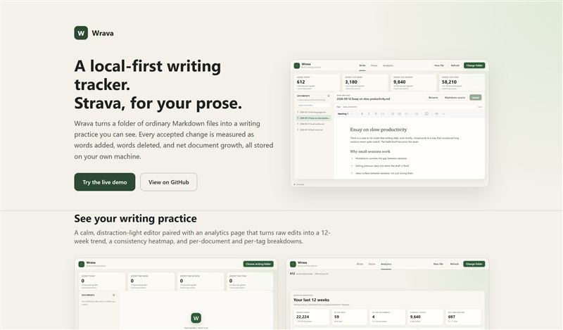<span class="pf-cardtitle">Wrava</span></div>
<div class="pf-cap"><div class="pf-oneliner">A local-first writing app that tracks and analyses your writing activity.</div></div>
</a>
<a class="pf-card col-12 col-md-4" href="projects.html#dominium">
<div class="pf-thumb"><span class="pf-badge">TypeScript</span>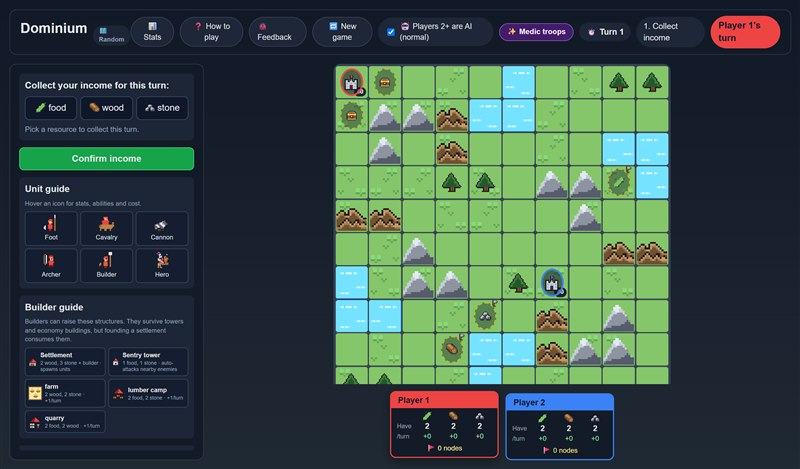<span class="pf-cardtitle">Dominium</span></div>
<div class="pf-cap"><div class="pf-oneliner">A turn-based strategy game for 2 to 4 players, playable in the browser.</div></div>
</a>
<a class="pf-card col-12 col-md-4" href="https://martinctc.github.io/opencode-dashboard/" target="_blank" rel="noopener">
<div class="pf-thumb"><span class="pf-badge">Python</span>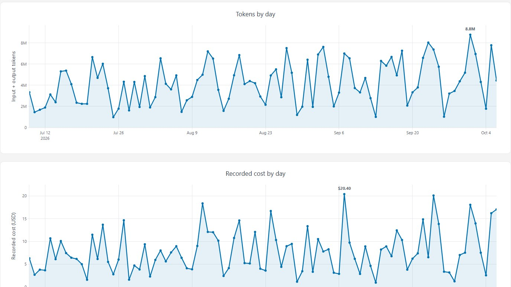<span class="pf-cardtitle">OpenCode Dashboard</span></div>
<div class="pf-cap"><div class="pf-oneliner">A local, read-only dashboard for exploring your OpenCode token usage.</div></div>
</a>
<a class="pf-card col-12 col-md-4" href="https://martinctc.github.io/house-of-cats/" target="_blank" rel="noopener">
<div class="pf-thumb"><span class="pf-badge">TypeScript</span>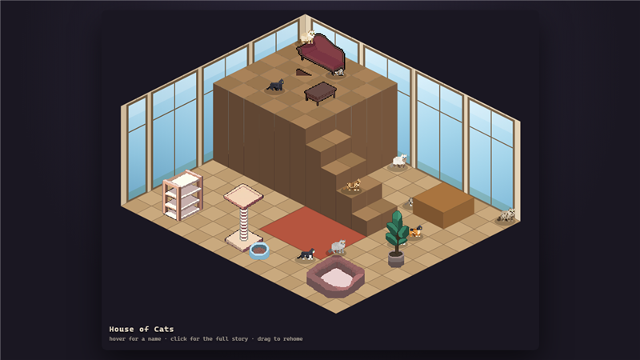<span class="pf-cardtitle">House of Cats</span></div>
<div class="pf-cap"><div class="pf-oneliner">An experimental isometric 2.5D browser scene with pixel-art cats.</div></div>
</a>
<a class="pf-card col-12 col-md-4" href="https://martinctc.github.io/bike-routes/" target="_blank" rel="noopener">
<div class="pf-thumb pf-thumb--css pf-css-bike"><span class="pf-badge">JS</span><span class="pf-glyph">&#128690;</span><span class="pf-cardtitle">Bike Routes</span></div>
<div class="pf-cap"><div class="pf-oneliner">A curated collection of cycling routes, with maps, elevation profiles and GPX downloads.</div></div>
</a>
<a class="pf-card col-12 col-md-4" href="projects.html#interval-tracks">
<div class="pf-thumb"><span class="pf-badge">JS</span><span class="pf-cardtitle">Interval Tracks</span></div>
<div class="pf-cap"><div class="pf-oneliner">Generated workout audio entirely from code.</div></div>
</a>

<a class="pf-card col-12 col-md-4" href="https://github.com/martinctc/ds-quiz" target="_blank" rel="noopener">
<div class="pf-thumb pf-thumb--css pf-css-quiz"><span class="pf-badge">JS</span><span class="pf-glyph">&#128221;</span><span class="pf-cardtitle">ds-quiz</span></div>
<div class="pf-cap"><div class="pf-oneliner">A single-page assessment tool for data science knowledge.</div></div>
</a>

</div>
</div>
```

<div class="mycontent">

For a closer look at each of these projects, I've written up the ideas and
thinking behind them on the [vibe-coded projects page](projects.html).

---

## Blogs

On this same site you can find my [blog](https://martinctc.github.io/blog), where I write about things related to #rstats and data science. I contribute my blogs to [r-bloggers](https://www.r-bloggers.com/), [R Craft](https://www.r-craft.org/), and [R Weekly](https://rweekly.org), which you can find as an example two of my blogs featured in the [2019 Week 17 update](https://rweekly.org/2019-17.html) on R Weekly. My post on the [state of R artefacts](https://martinctc.github.io/blog/a-short-essay-on-duplicated-r-artefacts/) is also selected as the highlight post of [2019 Week 27](https://rweekly.org/2019-27.html) on R Weekly.

### Highlight posts

- [RStudio Projects and Working Directories: A Beginner's Guide](https://martinctc.github.io/blog/rstudio-projects-and-working-directories-a-beginner%27s-guide/) - a starter guide on setting up effective, collaboration-friendly directories - a must read for beginners in R. Special thanks to Chu Kyoyoung for translating this post into [Korean](https://chukycheese.github.io/data%20science/rstudio-project-and-working-directories/).

- [Using data.table with magrittr pipes: best of both worlds](https://martinctc.github.io/blog/using-data.table-with-magrittr-pipes-best-of-both-worlds/) - a post on combining the strengths of the wildly popular **tidyverse** and the blazing fast **data.table** packages

- [LondonR: Hadley Wickham & tidyverse's greatest hits](https://martinctc.github.io/blog/londonr-hadley-wickham-and-tidyverse-greatest-hits/) - a post covering the highlights of Hadley Wickham's presentation at LondonR in August 2019.

## EARL Conference 2018
_Enterprise Applications of the R Language Conference (London)_

</div>
<br><br>

```{r, echo=FALSE}
htmltools::includeHTML("parallax/earlconf-header.html")
```

<div class="mycontent"><br><br>

<div style="float:left; position:relative; width:200px; left: -20px;"> 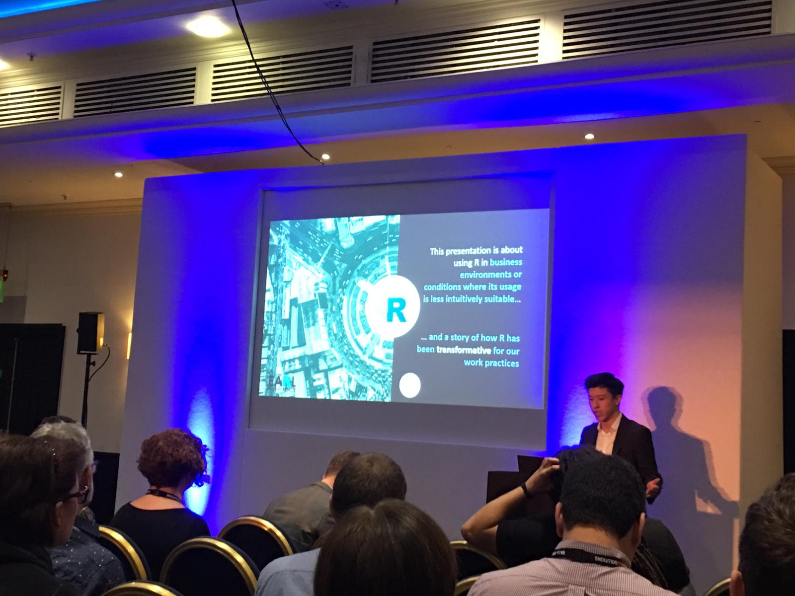 </div>

I presented at the EARL Conference 2018 on the challenges of using R for market research, and outlining some of the packages and approaches that help overcome these challenges. 

<br><br>

Check out my blog on using R for market research and strategy planning below:

[Swiss Army Knife for Strategy Planning](http://www.rainmakerscsi.com/blog/swiss-army-knife-strategy-planning)

<a href="downloads/EARL 2018 - Swiss Army Knife for Market Research - Martin Chan - 10 September 2018.pdf#" class="download" title="Download slides as PDF">Download slides</a>

---

## Interview with Jonathan Ng

_A YouTube Interview on R, Data Science, and Market Research_

</div>
<br><br>

```{r, echo=FALSE}
htmltools::includeHTML("parallax/interview-header.html")
```

<div class="mycontent"><br><br>

[Jonathan Ng](https://datastrategywithjonathan.com/) is a best-selling instructor and Data Scientist who interviewed me on how I use R in a market research and consulting environment, and my personal journey from Excel to R. Check out the full interview here:

<br>
<div class="pf-video">
<iframe src="https://www.youtube-nocookie.com/embed/o9wHpvIYBDM" title="Philosopher to Data Analyst / Strategy Consultant - interview with Jonathan Ng" loading="lazy" referrerpolicy="strict-origin-when-cross-origin" allow="accelerometer; autoplay; clipboard-write; encrypted-media; gyroscope; picture-in-picture; web-share" allowfullscreen></iframe>
</div>

</div>


