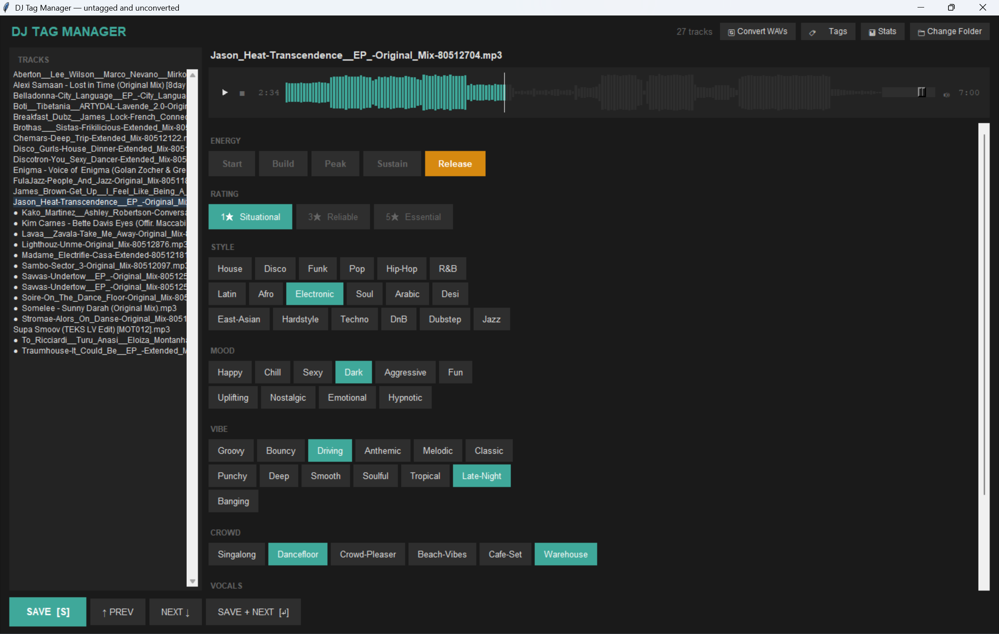
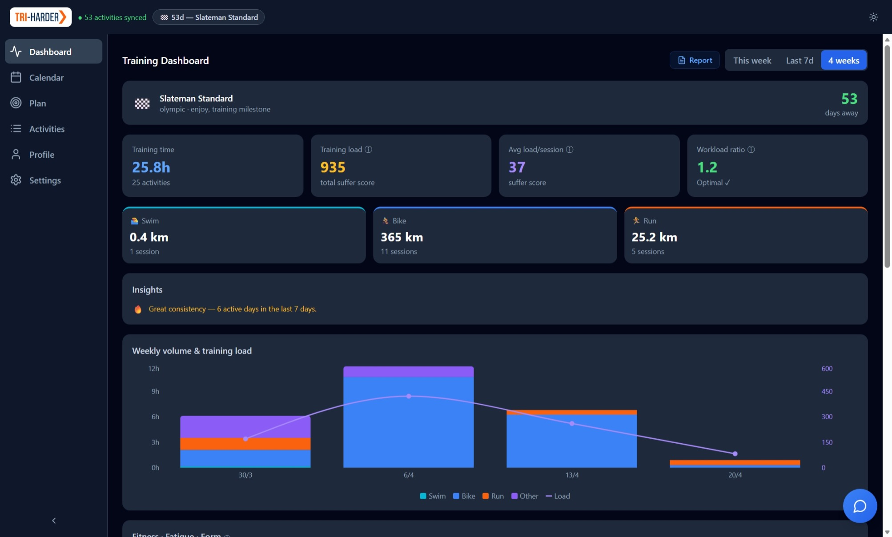
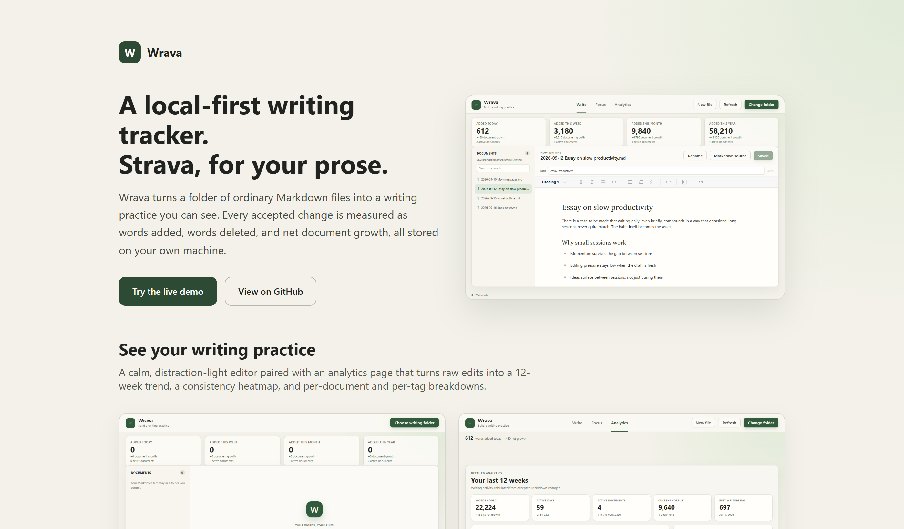
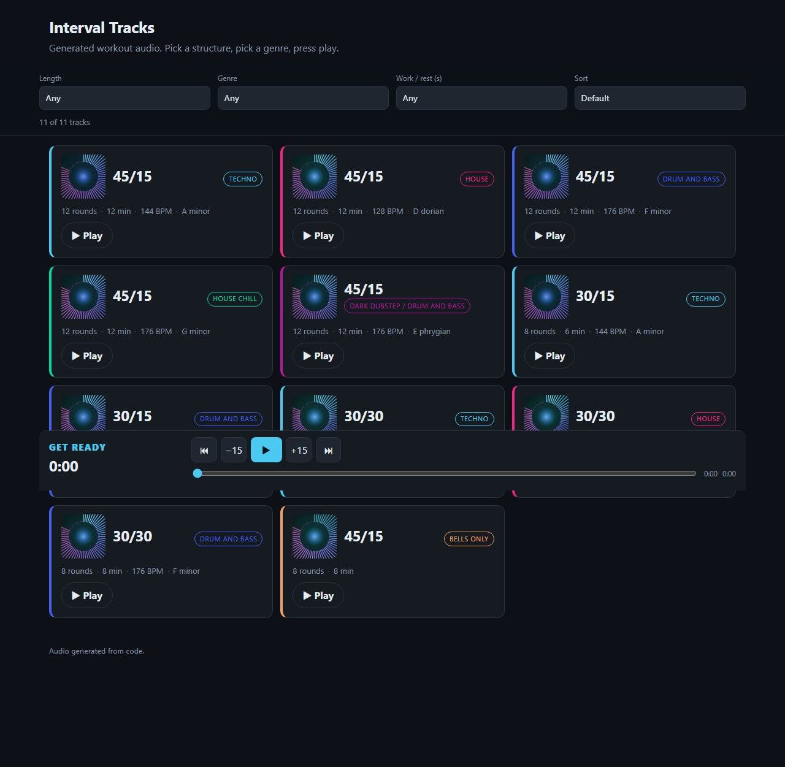
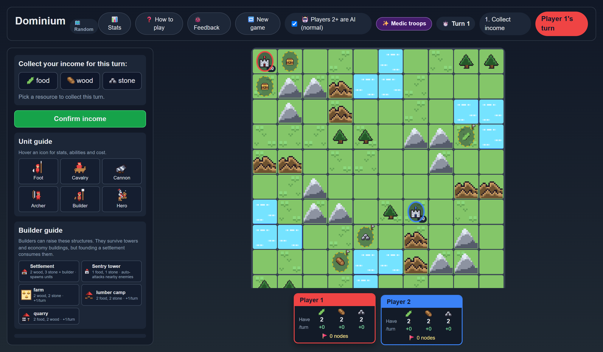

## Vibe-coded projects

Alongside R packages, I've recently been building small web apps and tools
through "vibe coding" — quick, exploratory builds where I use AI-assisted
development to turn an idea into a working tool as directly as possible.
These are typically self-contained, browser-based, and built for a specific
real-world need of mine.

---

### Track Tag Manager

<a href="portfolio.html">&uarr; All projects</a>

_A local Python app for tagging and organising tracks, designed for DJ workflows._

[Track Tag Manager](https://martinctc.github.io/track-tag-manager/) is a
Python desktop app I built to help manage track metadata as part of a DJ
workflow — making it easier to tag, filter, and curate tracks without being
locked into a single piece of DJ software. It runs locally and offline, so
your library never leaves your machine.

- Project page: <https://martinctc.github.io/track-tag-manager/>
- Source code: <https://github.com/martinctc/track-tag-manager>

---

### Tri Harder

<a href="portfolio.html">&uarr; All projects</a>

_An AI-powered triathlon coaching app._

[Tri Harder](https://martinctc.github.io/tri-harder-app/) is a browser-based
triathlon coaching app that uses AI to help athletes plan and adapt their
training across swim, bike, and run. It's designed to make structured,
personalised coaching accessible without needing a paid platform — runs
entirely in the browser, no install required.

- Live app: <https://martinctc.github.io/tri-harder-app/>
- Source code: <https://github.com/martinctc/tri-harder-app>

---

### Wrava

<a href="portfolio.html">&uarr; All projects</a>

_A local-first writing app that tracks and analyses your writing activity._

[Wrava](https://martinctc.github.io/wrava/) turns a folder of ordinary
Markdown files into a writing practice you can see. Every accepted change is
measured as words added, words deleted, and net document growth, so a
distraction-light editor doubles as an activity tracker. The analytics view
turns those raw edits into a 12-week trend, a consistency heatmap, and
per-document and per-tag breakdowns. It is open source, and everything stays
on your own machine.

- Project page: <https://martinctc.github.io/wrava/>
- Source code: <https://github.com/martinctc/wrava>

---

### Interval Tracks

<a href="portfolio.html">&uarr; All projects</a>

_Generated workout audio entirely from code — pick a structure, pick a genre, press play._

[Interval Tracks](https://martinctc.github.io/interval-tracks/) is a set of interval workout audio tracks generated entirely from code. Pick a structure (e.g. 45/15, 30/30) and a genre (dubstep, house, techno), and the app generates a workout playlist with text-to-speech guidance through each interval. Everything runs in the browser — no installation required.

- Live app: <https://martinctc.github.io/interval-tracks/>
- Source code: <https://github.com/martinctc/interval-tracks>

---

### Dominium

<a href="portfolio.html">&uarr; All projects</a>

_A turn-based strategy game for 2 to 4 players, playable in the browser._

[Dominium](https://martinctc.github.io/dominium/) is a grid-based strategy
game descended from a pen-and-paper game I played at school. Each player
defends a base, gathers food, wood and stone, and builds an army to destroy
every other base on the board. Turns run in three phases of income, build,
and act, with six unit types, builder structures, fog of war, and terrain
that shapes where you can move and build. You can play hot-seat with friends
or against AI opponents, and there is an experimental isometric view
alongside the classic pixel art.

- Play it now: <https://martinctc.github.io/dominium/>
- Source code: <https://github.com/martinctc/dominium>

